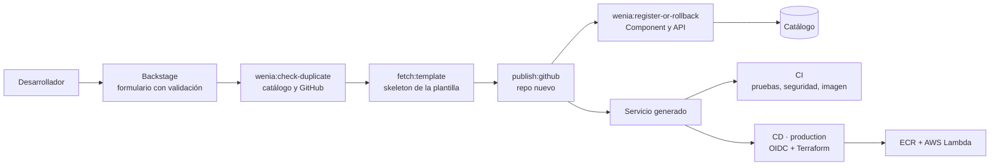

# backstage-templates

Plantillas de autoservicio de Backstage del caso técnico "Platform Engineer". Cada una convierte un formulario en un repositorio listo para trabajar: código, contenedores, CI/CD, Terraform, observabilidad, documentación y registro en el catálogo.

Este repo contiene solo las plantillas, para que evolucionen por separado del portal. El portal, sus acciones propias y la infraestructura base están en [`wenia-platform`](https://github.com/jh-platform-lab/wenia-platform).

## Cómo funciona



1. El formulario rechaza entradas inválidas **antes** de ejecutar nada (nombre en formato DNS, equipo existente, tipo de servicio).
2. `wenia:check-duplicate` consulta el catálogo y GitHub; si el nombre existe, la tarea falla en el primer paso sin crear nada.
3. `fetch:template` renderiza el `skeleton/` con los datos del formulario.
4. `publish:github` crea el repositorio en la organización.
5. `wenia:register-or-rollback` registra el servicio y su API en el catálogo; si falla, borra el repo recién creado y la tarea queda fallida.

## Plantillas

| Plantilla | Genera | Versión |
|---|---|---|
| `python-service` | Microservicio Python (FastAPI), Lambda o Kubernetes. **Flujo de AWS completo** | 1.6.6 |
| `nodejs-service` | Microservicio Node.js (Express), Lambda o Kubernetes | 1.5.4 |
| `go-service` | Microservicio Go (net/http, imagen distroless) | 1.5.4 |
| `java-service` | Microservicio Java 21 (Spring Boot 3) | 1.5.4 |
| `s3-bucket` | Bucket S3 privado con KMS, versionado y TLS (Terraform, checkov, CD con OIDC) | 1.4.0 |
| `sqs-queue` | Cola SQS con DLQ, KMS y TLS (Terraform, checkov, CD con OIDC) | 1.4.0 |
| `update-service` | PR en un servicio existente con los archivos de plataforma a la última versión | 1.3.0 |
| `add-observability` | PR en un servicio existente con alertas y dashboard de New Relic | 1.3.0 |
| `team-registration` | PR en `wenia-platform` que registra un equipo en `catalog/teams/` | — |

## Qué trae un servicio generado

```
<servicio>/
├── app/, tests/            código y pruebas
├── Dockerfile              Kubernetes
├── Dockerfile.lambda       AWS Lambda (imagen de contenedor)
├── openapi.yaml            contrato; se registra como API en el catálogo
├── catalog-info.yaml       Component + API (anotación wenia.io/template-version)
├── k8s/                    Deployment, Service, probes y securityContext
├── terraform/              módulos locales: ecr-repo, github-cd-role, lambda-service
├── observability/          alertas y dashboard de New Relic como código
├── docs/, api-docs/        TechDocs del servicio y de su API
└── .github/workflows/      ci.yml y cd.yml, separados
```

## CI y CD del servicio

| | Cuándo | Qué hace |
|---|---|---|
| **CI** | PR y push | Pruebas, `terraform fmt/validate` y checkov, secretos, build de la imagen con Trivy, `actionlint`, docs estrictas, `terraform plan` (rol de solo lectura) y despliegue en Kind |
| **CD** | Merge a `main`, entorno `production` | `apply` de ECR y rol de CD, build y push de la imagen con el SHA, `apply` de la Lambda y `update-function-code` |

El CD asume un rol de AWS por OIDC; no hay llaves en el repo. Las variables `AWS_ROLE_ARN`, `AWS_PLAN_ROLE_ARN` y `TF_STATE_BUCKET` son de la organización y las crea el bootstrap de `wenia-platform`. Solo `python-service` tiene hoy este flujo; las demás plantillas de servicio conservan el CD anterior y están pendientes de migrar.

## Estructura del repositorio

```
templates/<nombre>/template.yaml   formulario, validación y pasos del scaffolder
templates/<nombre>/skeleton/       todo lo que se genera
CHANGELOG.md                       una entrada por cambio, con la versión de la plantilla
```

Cada plantilla es una carpeta autocontenida: Backstage muestra una card por carpeta y la descubre sola con `templates/*/template.yaml`.

## Cómo agregar o cambiar una plantilla

1. Crea o edita `templates/<nombre>/` (`template.yaml` + `skeleton/`).
2. Pruébala creando un servicio desde Backstage en local: con `yarn start` lee tu carpeta al instante.
3. Sube `templateVersion` en `template.yaml` y anota el cambio en `CHANGELOG.md`.
4. Abre un PR. Cada cambio pasa por revisión; Backstage solo lee lo que está en `main`.

Notas del skeleton: los workflows se copian sin plantilla (`copyWithoutTemplating`) porque `${{ }}` choca con Nunjucks, y los archivos `.terraform.lock.hcl` se versionan a propósito. Las acciones de GitHub deben usar runtime Node 24.

## Evolución

Cada servicio guarda `wenia.io/template-version` en su `catalog-info.yaml`; comparándola con la versión actual se sabe qué servicios quedaron atrás, y la plantilla `update-service` abre el PR para ponerlos al día.
