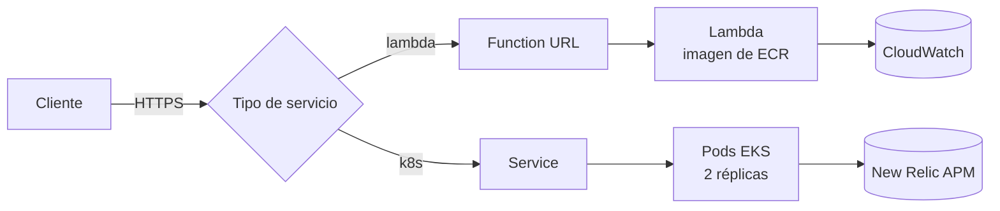
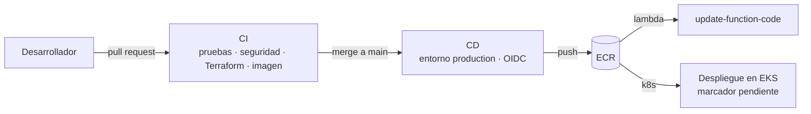

# Arquitectura

Cómo corre el servicio y cómo llega a producción.

## Ejecución

La imagen se construye una vez y se usa en los dos tipos de despliegue. El tipo lo decide el campo `serviceType` del formulario (`${{ values.serviceType }}` en este servicio).

## Entrega

!!! note "Estado del despliegue a Kubernetes"
    El CD publica la imagen en ECR. El paso de despliegue en EKS es un marcador hasta que exista el cluster.

## Componentes

| Componente | Archivo | Función |
|---|---|---|
| Aplicación | `src/main/java/com/wenia/service/ApiController.java` | Rutas y lógica del servicio |
| Contrato | `openapi.yaml` | Documento de la API, registrado en el catálogo |
| Imagen K8S | `Dockerfile` | Usuario sin privilegios, sin shell de administración |
| Imagen Lambda | `Dockerfile.lambda` | AWS Lambda Web Adapter |
| Infraestructura | `terraform/` | ECR, rol OIDC de CD y función Lambda (si hay `image_uri`) |
| Kubernetes | `k8s/` | Deployment de 2 réplicas, probes y Service |
| Observabilidad | `observability/newrelic/` | Alertas y dashboard como Terraform |
| Catálogo | `catalog-info.yaml` | Component y API en Backstage |
